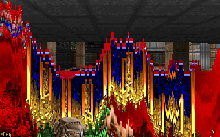
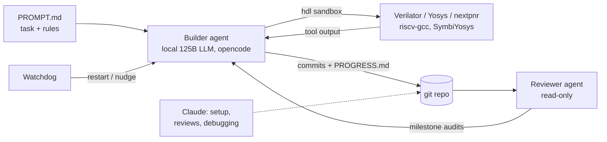

# rv32cpu: a RISC-V CPU that runs DOOM, built by a local AI agent

[](https://github.com/jemkox/agent-riscv-doom/actions/workflows/ci.yml)

<p align="center">
  
</p>

A 5-stage pipelined **RV32IM** CPU written in SystemVerilog. It passes the
official RISC-V test suites, routes on a **Lattice iCE40 UP5K** FPGA, and runs
**DOOM** (shareware, unmodified game logic) cycle-accurately in Verilator, with
a live window and keyboard. It also boots the **FreeRTOS** real-time operating
system and passes a self-checking multitasking demo.

The design (about 2,700 lines of RTL), its tests and the Doom port were written
autonomously by a **local LLM coding agent** running on a consumer PC. I designed
the agent setup, the task, and the verification rules it had to obey, and
reviewed the milestones. Claude (Anthropic) assisted with setup and review,
including the fixes for the bugs Doom and FreeRTOS found; every commit it touched is
marked `Co-Authored-By: Claude`. See [How it was built](#how-it-was-built).

## Why I built this

I want to work on AI for hardware design: using AI agents to design and verify
chips. Before applying anywhere, I wanted to find out for myself whether that
actually works today, on hardware I own, without a cloud model writing the code.

So I set a local coding model up on my own gaming PC (12 GB GPU, 32 GB RAM) and
gave it a real engineering task: design a RISC-V CPU from scratch, prove it
correct, and make it run DOOM. My job was not to write the Verilog but to build
the system around the agent: the sandbox, the rules, the watchdog that keeps it
working, and an independent reviewer that checks every claim it makes.

What I learned:

- **An AI agent will claim things that are not true.** The builder reported
  test suites as passing when they were failing. The reviewer agent caught it
  and the fix list sent it back to work. Verification has to be built into the
  loop, not added at the end.
- **Passing tests is not the same as being correct.** The CPU passed every
  official test and thousands of random programs, and DOOM still found two
  real pipeline bugs. Real workloads matter.
- **A local model can do serious engineering work** if the setup around it is
  strict: measured numbers only, self-checking tests, and nothing taken on trust.

This is the kind of work I want to do: making AI reliable enough to build
hardware.

## Results

| | |
|---|---|
| ISA | RV32I + M (mul/div) + Zicsr, machine mode, timer interrupt |
| Pipeline | 5 stages (IF ID EX MEM WB), full forwarding, load-use stall, BTB with 2-bit counters |
| Caches | 16 KB I + 16 KB D, direct-mapped, 16 B lines, configurable miss latency |
| Official tests | `rv32ui` all pass, `rv32um` all pass, 15 `rv32mi` tests pass |
| Random testing | 500–5000 random programs per run, compared instruction-by-instruction with a Python reference model: 0 mismatches |
| Formal | k-induction proof of pipeline invariants (SymbiYosys) |
| CoreMark | **3.19 CoreMark/MHz** (EEMBC CoreMark 1.0, CRCs validated, GCC 13.2 `-O2`) |
| Operating system | **FreeRTOS** V11.2.0 (own port): tasks, queue, mutex, preemption, software timers, 185 context switches in the demo |
| DOOM | runs to gameplay; 3.99M cycles/frame avg (~2.3M per rendered frame), IPC 0.91 |
| FPGA (iCE40 UP5K) | current `make fpga_full FPGA_FREQ=13 FPGA_SEED=4`: honest UP5K proof-fit gate using `fpga_top`: **527 SB_LUT4 / 195 SB_DFF**, 8 RAM, Max freq 22.85–23.68 MHz. The fixed full `fpga_pipe_top` netlist measures **6533 SB_LUT4 / 850 SB_CARRY**, 145% of UP5K; Tang Nano 20K nextpnr-himbaechel is not installed here. Dedicated `fpga_csrtrap_netlist`: **5544 SB_LUT4 / 1667 SB_DFF** |

What that means in frames per second:

| Where | Speed |
|---|---|
| Verilator on a desktop PC (5.8M cycles/s) | ~1.4 fps, playable as a slideshow |
| Real FPGA at 13 MHz | ~3 fps (needs a board with ~8 MB RAM; see limits) |
| Same CPU at 50 MHz | ~12.5 fps |

## Benchmark: CoreMark

[EEMBC CoreMark](https://github.com/eembc/coremark) 1.0, 2K performance run,
500 iterations, on the same CPU configuration that runs Doom (16 KB + 16 KB
caches, 5-cycle memory latency), timed with the CPU's own `mcycle` counter:

```text
CoreMark 1.0 : 41.504125 / GCC13.2.0 -O2 / STACK      (reported at the 13 MHz FPGA clock)
Correct operation validated.
Total ticks 156,610,941 for 500 iterations = 313,222 cycles/iteration
=> 3.19 CoreMark/MHz      IPC 0.867, branch mispredictions 13.7%
```

For context, published numbers of well-known open-source RV32 cores
(from their READMEs; different compilers and flags, so not an exact comparison):

| Core | CoreMark/MHz |
|---|---|
| **rv32cpu (this project)** | **3.19** |
| lowRISC Ibex, maxperf config | 3.13 |
| VexRiscv, full max perf (8 KB caches) | 2.57 |
| lowRISC Ibex, small config | 2.47 |
| VexRiscv, full (4 KB caches) | 2.30 |

This is a self-run result in cycle-accurate simulation, not an EEMBC-certified
score. Run it with `make coremark`; CI runs it on every push.

## Booting an operating system: FreeRTOS

[FreeRTOS](https://github.com/FreeRTOS/FreeRTOS-Kernel) V11.2.0, the kernel
unmodified, runs on the same CPU configuration as Doom. This CPU's trap model is
simplified (one `mstatus` bit enables traps and the timer, the timer lives in
CSRs, `ecall` halts when traps are off), so the stock RISC-V port does not fit;
[`os/freertos/port/`](os/freertos/port/) is a small port written for it, which
yields by making the timer interrupt due, like PendSV on ARM Cortex-M. The demo
checks itself:

```text
FreeRTOS V11.2.0 on rv32cpu
ticks=60
context switches=185
queue sum=1275            (50 numbers through a queue, in order)
queue order errors=0
mutex count=40            (2 tasks x 20, switched out while holding the mutex)
spinner A=86097           (two tasks that never block both progress:
spinner B=86710            the tick preempts them)
timer callbacks=12
FREERTOS PASS
```

Run it with `make freertos`; CI runs it on every push.

### Three more CPU bugs that FreeRTOS found

The official tests, 5,000 random programs and Doom all passed, and an operating
system still found three bugs. Each now has a directed test:

1. **`mret` was decoded with the wrong encoding** (`0x300` instead of `0x302`),
   so every real `mret` was an illegal instruction. The reference model had no
   `mret` either, and the official-test environment replaces `mret` with a
   macro, so nothing ever executed one. Test: `tests/t16_mret.S`.
2. **`mret` read a stale `mepc`** when the instruction right before it wrote
   `mepc`. Fix: use the forwarded CSR value.
3. **CSR writes used the un-forwarded register value**: `lw t0, ...` followed by
   `csrw mepc, t0` wrote the *old* `t0`. Fix: take the forwarded operand, like
   the ALU does. Test: `tests/t17_csr_fwd.S`.

After the fixes every suite passes again, Doom runs with the exact same cycle
count, and CoreMark is unchanged.

## Two real CPU bugs that only DOOM found

All the official tests and thousands of random programs passed, and the CPU was
still wrong. Doom exposed two pipeline hazards, which were then turned into
directed tests that fail on the old RTL:

1. **Store during a load-use stall.** A store held in EX by a stall still sent
   its memory access with a not-yet-forwarded address and wrote a random
   location. In Doom this corrupted libc's character table.
   Fix: gate memory access with `!stall`. Test: `tests/t14_ldst_stall.S`.
2. **Forwarded operands lost during a stall.** `lw s6; lw a5; blt a5,s6`: the
   value of `s6`, forwarded from writeback, was gone by the time the stall
   ended, so the branch compared a stale register. In Doom: "bad texture
   directory" and striped frames. Fix: latch the forwarded operands.
   Test: `tests/t15_ld_ld_br.S`.

## Quick start

### Requirements

Tested on Ubuntu 24.04:

```sh
sudo apt install verilator yosys nextpnr-ice40 fpga-icestorm \
  gcc-riscv64-unknown-elf picolibc-riscv64-unknown-elf libsdl2-dev python3 make
```

Versions used: Verilator 5.020, Yosys 0.33, nextpnr 0.6, riscv64-unknown-elf-gcc
13.2, picolibc 1.8.6, SDL 2.30. SymbiYosys + z3 are only needed for the formal
check.

### Get the test suites and Doom

```sh
git clone https://github.com/jemkox/agent-riscv-doom.git && cd agent-riscv-doom
make deps    # clones riscv-tests, CoreMark and FreeRTOS at pinned versions into deps/
```

For Doom, copy the shareware `doom1.wad` (v1.9, sha1
`5b2e249b9c5133ec987b3ea77596381dc0d6bc1d`) to `deps/doom1.wad`. It is not
included here; the build checks its checksum.

### Run

```sh
make test        # directed + official + random tests, prints ALL PASS
make all_tests   # every suite, including Doom
make coremark    # CoreMark score
make freertos    # boot FreeRTOS, self-checking demo
make doom        # headless Doom, frames in build/doom/frames
make play        # live SDL window with keyboard
make play_test   # scripted play, must differ from a no-key run
make fpga_full FPGA_FREQ=13 FPGA_SEED=4   # synth + place & route for iCE40 UP5K
make fpga_csrtrap_netlist                 # yosys + netlist checker for tests/fpga_csrtrap.S ROM
make fpga_toy, fpga_toy_test              # LEGACY single-cycle toy proof top (fpga_top); not the full CPU
```

Any input can also be given directly: `RVTEST_DIR=.../riscv-tests/isa`,
`COREMARK_DIR=...`, `WAD_SRC=.../doom1.wad`. A missing one stops the build
with a message saying what to do.

Controls in `make play`: arrows move, Ctrl fires, Space opens doors, Enter/Esc
for menus, 1–7 select weapons, `-` shrinks the view (faster).

## Repository layout

```text
rtl/        CPU in SystemVerilog (top_pipe.sv is the pipeline; *_fpga.sv are FPGA variants)
tb/         Verilator testbenches (C++ and SV), including the Doom play harness
tests/      17 directed assembly tests
iss/        Python reference instruction-set simulator
tools/      random program generator, trace compare, play-test verifier, helpers
formal/     SymbiYosys pipeline proof
programs/   small C benchmarks (fib, sort, matmul, ...)
os/         FreeRTOS port for this CPU and the self-checking demo
bench/      CoreMark port (timer = mcycle, UART output)
doom/       Doom port: crt0, linker script, file layer, MMIO glue; doom/src = doomgeneric (vendored, upstream e257a09)
docs/       DESIGN.md (detailed design notes and numbers), Doom screenshots
agent/      the agent harness (installable): sandbox, loop plugin, watchdog, reviewer, 3 real review reports
PROMPT.md   the task specification the AI agent worked from
PROGRESS.md the agent's lab notebook: every milestone, bug, root cause and measurement
```

The detailed microarchitecture, verification approach, measured metrics and
optimization history are in [`docs/DESIGN.md`](docs/DESIGN.md).

## How it was built

- **The builder** is an open-weight coding model (Qwen 3.8 Flash Next Coder,
  125B parameters, 1.75-bit quantization) running locally on a PC with a 12 GB
  GPU and 32 GB RAM, driven by [opencode](https://opencode.ai) in a sandbox that
  could only run the HDL tools.
- **The rules** ([`PROMPT.md`](PROMPT.md)): every number must come from tool
  output, every testbench is self-checking, never edit a test to make it pass,
  a fresh-clone check before every commit, and a milestone list from
  "single-cycle RV32I" to "Doom runs".
- **Supervision:** a watchdog restarted the agent when it stalled, and a
  second, read-only reviewer agent audited each milestone. Claude (Anthropic)
  was used for setup, reviews and debugging: it diagnosed and fixed the two
  bugs Doom found and the three FreeRTOS found (about 35 lines of RTL, each
  with a directed test), fixed the Doom linker script and the keyboard timing
  in the play harness, caught a play test that passed even with a dead
  keyboard, and wrote this README, the CoreMark port and the FreeRTOS port.


- **Timeline:** first commit 2026-10-31 23:27, finished 2026-11-02 10:39
  (about 35 hours).

The complete harness (sandbox, loop plugin, watchdog, reviewer agent) is in
[`agent/`](agent/), together with three reports the reviewer wrote during the
build, including a **FAIL** where it caught the builder breaking an official
test. [`PROGRESS.md`](PROGRESS.md) keeps the full history, including the
failed attempts.

## Who did what

GitHub lists Claude as a contributor because its commits carry a
`Co-Authored-By: Claude` line. Here is what those lines are, next to everyone
else's part:

| Who | What |
|---|---|
| **Me (jemkox)** | The idea and the goals (verified CPU, then Doom, then benchmarks); running the model locally; the agent setup and its rules (built together with Claude); supervising the build, deciding priorities and when to step in. |
| **Builder agent** (local Qwen 3.8 Flash Next Coder) | The CPU: all RTL except about 35 lines (`rtl/`, about 2,700 lines today), the Python reference model, the random test generator, directed tests t01–t14, the testbenches, the FPGA flow, the Doom port's file layer and runner, and the `PROGRESS.md` log. 36 commits on its own, about 11,000 lines added over the build (excluding the vendored Doom source). |
| **Reviewer agent** (same local model) | The three reports in [`agent/reviews/`](agent/reviews/). |
| **Claude** (Anthropic), the co-authored commits | About 35 lines of RTL: the fixes for the two bugs Doom found and the three FreeRTOS found, plus tests t15–t17 and `mret` in the reference model. The FreeRTOS port and demo (`os/`, ~400 lines). Debugging fixes outside the CPU (Doom linker script, file layer, play-window keyboard timing). The agent harness scripts in `agent/`, written with me during setup (~1,600 lines). The CoreMark port (~1,300 lines, mostly EEMBC's own template files), the CI workflow, the installer, and this README and `docs/`. Some of these commits also carried the builder's own work. |
| **Third-party code** | [doomgeneric](https://github.com/ozkl/doomgeneric) (`doom/src`), EEMBC CoreMark, FreeRTOS kernel subset vendored under `deps/FreeRTOS-Kernel` (pinned V11.2.0, pruned to the files the build uses), riscv-tests conventions (`env/`). |

## What's next

- Run DOOM on a real FPGA board with SDRAM (e.g. an ECP5 board), where it
  should reach roughly 12–20 fps.
- Raise the FPGA clock beyond 13 MHz by pipelining the critical path.
- Boot Linux on real hardware: needs an SDRAM board; the FPGA top does not
  yet carry S/U modes, the MMU or CLINT (only the simulation CPU does).

## Linux notes

- **Pinned Linux kernel:** the simulation kernel used by the Linux targets is
  **blob-pinned in git**, not reproduced end-to-end by `make linux_rebuild_kernel`.
  The blob is `linux_kernel_blob.bin` / blob id `09a6ad3ee685bf98496dafdafd70ef5977806528`;
  `make linux_pinned_kernel` recovers it, patches out the embedded initramfs, and produces
  `linux/vmlinux.bin` with `KERNEL_SHA256 2bdaf20814e28e45ac315fc7db5cadd079dfeecfe99e9f06691772ee77aaf0bd`.
  `linux_rebuild_kernel` is the Buildroot recipe for the source kernel image, but it is not
  sufficient to reproduce the pinned patched artifact by itself.
- **UART device layout for the Linux machine:** the NS16550-style UART page is
  `0x1000_0000`; data is at `+0x000` (`0x1000_0000`), status is at `+0x005`
  (`0x1000_0005`), and the device value consumed by the simulation for UART data loads is
  `0x60 | rx_pending` (ready without a pending RX byte is `0x60`; pending RX is `0x61`).

### Booting Linux on the finished CPU (reproducible)

- `hdl make linux` reproduces the whole L7/L8 boot from committed source and
  pinned image shas: Buildroot/OpenSBI `fw_jump.bin`, Linux 6.12.27 MMU
  `Image`, canonical rootfs sha `0fda249a...` with a minimal L7/L8 `rcS`, and
  `linux/linux_mmu.dtb` generated from the committed DTS. It saves a fresh
  checkpoint at 220M cycles, restores it, then scripts login, `uname -a`,
  `cat /proc/cpuinfo`, `ls /`, and `echo LINUX_SIM_DONE`. The observed full
  reproduction is ~13 min wall at ~1.6M cycles/s (build cached); the run is
  deterministic with fixed MT seed and fixed rootfs canonicalization.
- Cycle counts for the current `hdl make linux` boot: login prompt detected at
  427M cycles (approx.); `#LINUX cycles=1326849360 insns=1753061298 prompt=1 login=1 done=1 halt=0 cmds=1`.
- Boot log excerpt (`build/linux/logs/shell.out`):

```
buildroot login: root
Jan  1 00:00:00 login[57]: root login on 'console'
# uname -a
Linux buildroot 6.12.27 #4 SMP Sun Nov  8 12:02:41 CET 2026 riscv32 GNU/Linux
# cat /proc/cpuinfo
processor	: 0
hart		: 0
isa		: rv32ima_zicntr_zicsr_zifencei_zihpm
mmu		: sv32
# ls /
bin  init  lib  proc ...
# echo LINUX_SIM_DONE
LINUX_SIM_DONE
#STOP cyc=1326849360 login=1 prompt_stop=0 done=1 shell_stop=1 panic=0 past_panic=0 halt=0
#LINUX cycles=1326849360 insns=1753061298 prompt=1 login=1 done=1 halt=0 cmds=1 dtb=83e00000
```

## Honest limits

- DOOM runs in **simulation**. The UP5K has 128 KB of RAM and Doom needs about
  8 MB, so the FPGA build proves the CPU fits and meets timing, but runs a small
  built-in program. A board with SDRAM is needed to play it on real hardware.
- Simulation speed peaked at 5.8M cycles/s; a 15M target was attempted and missed
  (attempts recorded in `PROGRESS.md`).
- The Linux boot runs **only in simulation**. The simulation CPU is RV32 with
  A/LR/SC and `AMO*`, S/U modes with `mstatus.SPP`, the Sv32 MMU (two-level
  page-table walk, 4-entry direct-mapped TLB per side), CLINT
  (`0x1FC0_0000`), a 64KiB direct-mapped 32-bit-line I/D data cache (128KiB
  total) and the 16MiB `rv32-linux-sim` dtb/rootfs pins. One reproduction of
  the boot takes ~13 min of wall time (checkpointed 220M-cycle save plus
  restore to `LINUX_SIM_DONE`; login around 427M cycles, done at 1.32685B cycles);
  the console is serial-only — no networking (the pinned rootfs has no network
  daemons) and no GUI. The FPGA top (`fpga_pipe_top`) has no CLINT, no S/U
  modes and no MMU (under `ifdef FPGA` WFI never executes and the FPGA SYSTEM
  decoder keeps its Fmax shape where csr 0x100 is illegal). WFI is a builder
  convention (not a spec requirement in this project): simulation accepts f3=0
  SYSTEM encodings for `0x100` (x10000073) and `0x105` (x10500073) and retires
  them as IRQ-wait no-ops when no IRQ is pending; a pending IRQ traps before
  retirement.
- The formal proof covers pipeline invariants, not full ISA equivalence.
- The FPGA build truncates the 64-bit counters to 32 bits.

## License

MIT for this project's own code, see [LICENSE](LICENSE). `doom/src` is
doomgeneric (GPL v2). DOOM is a trademark of id Software; the WAD is not
included.
